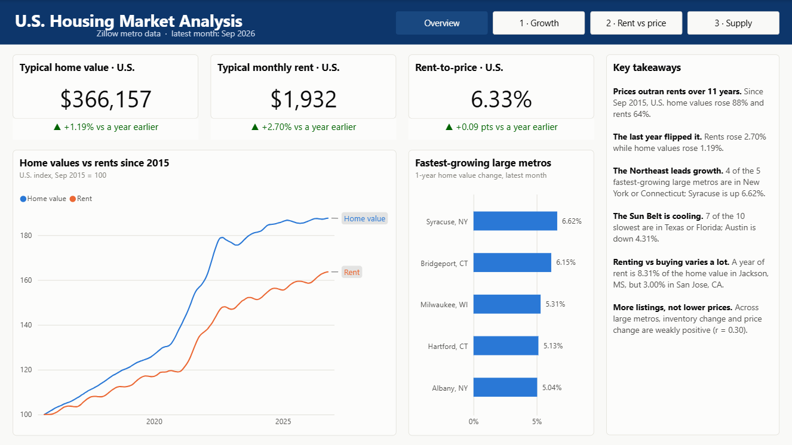
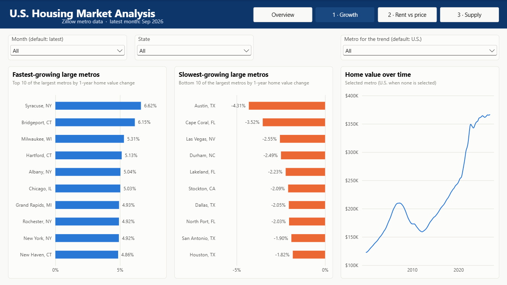
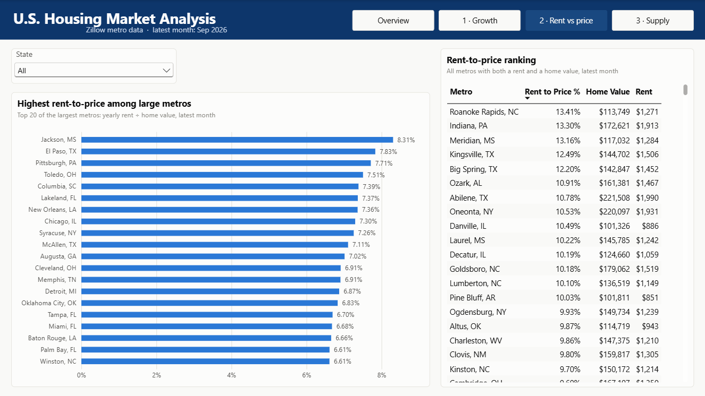
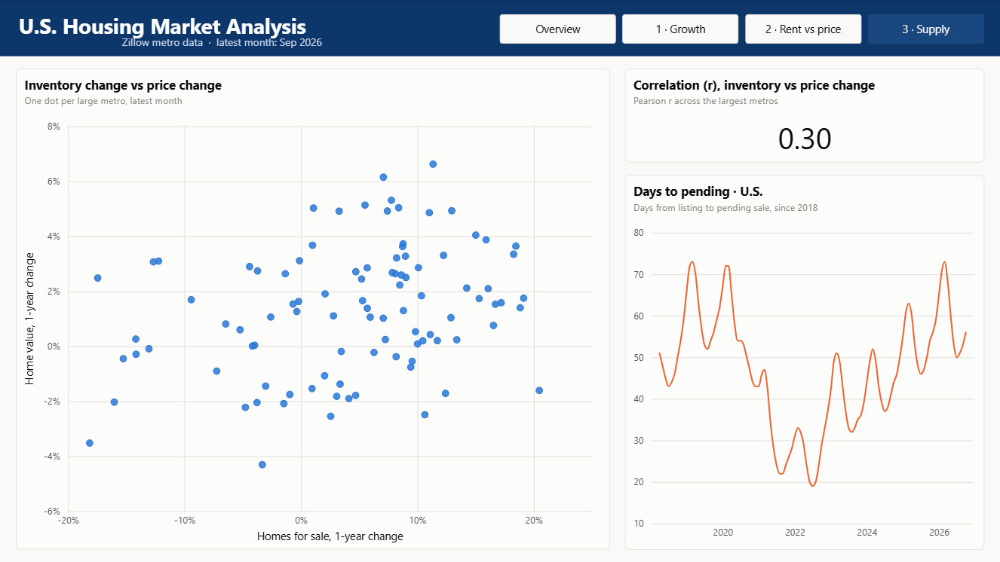

# U.S. Housing Market Analysis

SQL Server + Power BI analysis of home values, rents and housing supply across U.S. metros, using Zillow data from January 2000 to September 2026.



**In short:** since 2015, U.S. home values rose faster than rents (+88% vs +64%). Over the last year that flipped: rents rose 2.70% and home values 1.19%. Growth is now led by the Northeast, while Texas and Florida metros are cooling.

Every number in this README and on the dashboard is checked by [`sql/99_validation_checks.sql`](sql/99_validation_checks.sql) against values computed separately from the raw CSV files (60 checks, all passing).

## Questions and findings

### 1. Which metros have grown fastest year over year?



Among the largest metros (Zillow size rank 1–100), **Syracuse, NY grew fastest: home values +6.62%** from Sep 2025 to Sep 2026. **4 of the 5 fastest are in New York or Connecticut.** At the other end, **Austin, TX fell 4.31%**, and **7 of the 10 slowest are in Texas or Florida**. The U.S. as a whole rose 1.19%.

### 2. Where is the rent-to-price ratio highest?



Rent-to-price is a year of rent as a share of the home value. Among the largest metros it is **highest in Jackson, MS (8.31%)** and **lowest in San Jose, CA (3.00%)**. That means a year's rent buys almost three times as large a share of a home in Jackson as in San Jose. The U.S. figure is 6.33%, up 0.09 points over the year, because rents grew faster than prices.

### 3. How do inventory and days on market relate to price changes?



Across the largest metros, the 1-year change in homes for sale and the 1-year change in home values are **weakly positive (r = 0.30)**. Metros with more listings did not, on the whole, see lower prices. The link between days to pending and price change is close to zero (r = 0.06). Nationally, a home took **56 days** to go pending in Sep 2026, 2 days more than a year earlier.

## How it works

```
4 Zillow CSVs (wide: one column per month)
   │  02  dynamic-SQL loader reads each header and builds a matching table
   ▼
raw.*  (wide copies)
   │  03  unpivot to long format, merge the 4 measures
   ▼
core.metro, core.metro_month  (one row per metro per month)
   │  04–06  growth, rent-to-price, supply vs price, correlations
   ▼
rpt.*  views ──► 07 star schema (dim_metro, dim_month, fact_metro_month) ──► Power BI
   │
   └─ 99  validation checks vs numbers computed independently in Python
```

| Script | What it does |
|---|---|
| [`01_create_database.sql`](sql/01_create_database.sql) | Database `HousingMarket` and schemas `raw`, `core`, `rpt` |
| [`02_load_raw_files.sql`](sql/02_load_raw_files.sql) | Procedure that reads a CSV's header, builds the table with dynamic SQL and bulk-loads it; handles quoted commas, byte-order marks and Windows line endings, and leaves no half-loaded table on error |
| [`03_build_core_tables.sql`](sql/03_build_core_tables.sql) | Unpivots every month column (generated from the catalogue, not typed by hand) into one long table |
| [`04_home_value_growth.sql`](sql/04_home_value_growth.sql) | Year-over-year change against the month exactly 12 months earlier, so gaps in a series never compare the wrong months |
| [`05_rent_to_price.sql`](sql/05_rent_to_price.sql) | Rent-to-price ratio |
| [`06_supply_vs_price.sql`](sql/06_supply_vs_price.sql) | Inventory and days-to-pending changes, and Pearson correlations built from plain aggregates |
| [`07_powerbi_views.sql`](sql/07_powerbi_views.sql) | Star-schema views for Power BI, including a gap-free month calendar |
| [`99_validation_checks.sql`](sql/99_validation_checks.sql) | 60 checks; the run fails if any check fails |

The dashboard is a Power BI Project ([`powerbi/us_housing_market.pbip`](powerbi/us_housing_market.pbip)), so the model (TMDL) and every page and visual (PBIR) are plain text you can read on GitHub. A [`.pbix` copy](powerbi/us_housing_market.pbix) is there for one-click download.

## How to run it

You need SQL Server 2022 or later (the calendar uses `GENERATE_SERIES`), [sqlcmd](https://learn.microsoft.com/sql/tools/sqlcmd/sqlcmd-utility) and Power BI Desktop.

1. Clone the repo.
2. Run the scripts in order, pointing `DataDir` at the repo's `data` folder. Add `-C` if your local server uses a self-signed certificate.

   ```
   sqlcmd -S localhost -E -b -I -i sql/01_create_database.sql
   sqlcmd -S localhost -E -b -I -v DataDir="C:\path\to\us-housing-market-analysis\data" -i sql/02_load_raw_files.sql
   sqlcmd -S localhost -E -b -I -i sql/03_build_core_tables.sql
   sqlcmd -S localhost -E -b -I -i sql/04_home_value_growth.sql
   sqlcmd -S localhost -E -b -I -i sql/05_rent_to_price.sql
   sqlcmd -S localhost -E -b -I -i sql/06_supply_vs_price.sql
   sqlcmd -S localhost -E -b -I -i sql/07_powerbi_views.sql
   sqlcmd -S localhost -E -b -I -i sql/99_validation_checks.sql
   ```

   `BULK INSERT` reads `DataDir` on the SQL Server machine. With `-E` (Windows login) it uses your own file rights, so the repo folder works. With a SQL login or a remote server, copy `data/` to a folder the server can read (for example `C:\HousingData`) and point `DataDir` there.

   The last script prints every check and ends with `All validation checks passed.` A full rebuild takes under 10 seconds.
3. Open `powerbi/us_housing_market.pbip` (or the `.pbix`) in Power BI Desktop. If your server is not `localhost`, change the `SqlServer` parameter (Transform data → Edit parameters), then click Refresh.

## Skills shown

- **SQL:** dynamic SQL (building tables from CSV headers), wide-to-long unpivot, window functions (`ROW_NUMBER`, `RANK`), self-joins for exact year-over-year comparisons, views, error handling with `TRY…CATCH`, re-runnable scripts.
- **Data quality:** 60 automated validation checks against independently computed reference values; bugs logged and fixed (see [`logs/bugs/`](logs/bugs)).
- **Power BI:** star schema, DAX measures (`CALCULATE`, `RANKX`, `HASONEVALUE`), parameterised data source, custom theme, edited interactions between visuals, Power BI Project format (TMDL + PBIR) under version control.

## Data

All four files are from [Zillow Research](https://www.zillow.com/research/data/), at metro level, monthly and smoothed: home values (ZHVI), rents (ZORI), for-sale inventory and days to pending. The files are kept unchanged in [`data/`](data), with sources and fingerprints in [`data/SOURCES.md`](data/SOURCES.md). The analysis ends in September 2026, the latest month with home values ([decision 0005](docs/decisions/0005-zillow-only-data.md)).

"Large metros" means Zillow size rank 1–100. Those ranks hold 99 regions (no file has rank 33), and 97 of them have home values.

## Repo structure
- `/data` raw source files
- `/sql` scripts, numbered in run order
- `/powerbi` Power BI report: project files (.pbip) and a .pbix copy
- `/screenshots` dashboard images
- `/docs` design, plans, decision records and templates
- `/logs` session journals, bug logs and test logs
- `/tools` the governance checker
- `/tests` tests for the checker and hooks

## Governance
The rules for this repo are in [CONSTITUTION.md](CONSTITUTION.md). AI agents start from [CLAUDE.md](CLAUDE.md).
Decisions are recorded in `docs/decisions/`, and every agent session, bug and test is logged in `logs/`.
Run `python3 tools/governance_check.py` to check the repo. The same check runs on GitHub for every change.
`main` is protected on GitHub by the "Protect main" ruleset (setup steps in [docs/github-setup.md](docs/github-setup.md)). AI agents work only in worktrees under `.worktrees/`, never on `main`.
